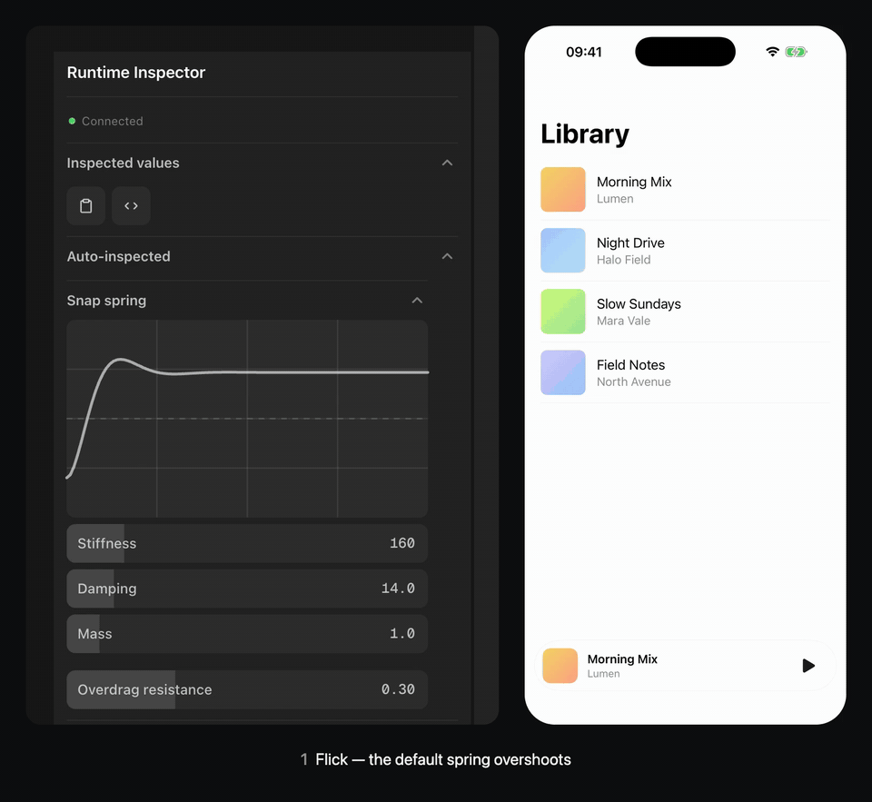

# Runtime Inspector

**Alpha · developer preview**

Runtime Inspector helps you inspect and fine-tune a running React Native app that uses Reanimated, without repeatedly editing code and comparing motion from memory. Expose runtime values and actions, explore supported animations, and adjust behavior live through a web panel, a Rozenite panel in React Native DevTools, or an MCP client. Supported source-anchored changes can be applied back to code. An experimental macOS Workbench runs from this repository.

## Demo

[](demo/spring-tuning.mp4)

The npm alpha in a fresh Expo app on the iOS Simulator. Flicked open, the mini player's sheet overshoots with the spring it starts with (`damping: 14`). Damping is raised in the web panel while the app runs, and the spring curve updates with it. The same flick then settles without a bounce, and **Apply to code** writes the new spring into `App.tsx`. [Watch the video](demo/spring-tuning.mp4).

## What works today

- Runtime controls through the SDK, including sliders, toggles, colors, springs, Bézier curves, and actions.
- Development-time discovery of supported Reanimated motion and scenes.
- Tuning through the web panel, React Native DevTools, MCP, and the experimental Workbench.
- Explicit **Apply to code** for supported source-anchored values.

These paths share the Runtime Inspector Protocol (RIP) and `panel-core` session behavior.

## Install in your app (npm alpha)

The npm alpha ships the SDK, the Babel plugin, the CLI (broker, web panel, Apply to code), the MCP client and the React Native DevTools panel. The desktop Workbench runs from this repository only.

From your Expo / React Native app root (Reanimated 3 or 4):

```bash
npm install @runtime-inspector/react-native@alpha
npm install --save-dev @runtime-inspector/babel-plugin@alpha @runtime-inspector/cli@alpha
npx runtime-inspector init     # Babel plugin + Metro wrapper; --dry-run to preview
npx runtime-inspector dev      # broker + web panel + Apply to code
```

Then start the app (`npx expo start`) and open the panel URL printed by `runtime-inspector dev`. If `init` created `babel.config.js` in an Expo app, it also asks for `npx expo install babel-preset-expo`. Run `runtime-inspector` through the locally installed CLI as above: an unrelated package named `runtime-inspector` exists on npm. Details in [Getting started](docs/getting-started.md).

To tune from React Native DevTools instead of the web panel, add `@runtime-inspector/panel-rozenite@alpha` and `@rozenite/metro` (dev), start Metro with `WITH_ROZENITE=true npx expo start` and open **Rozenite → Runtime Inspector** in DevTools; no CLI or broker is needed. Apply to code stays in the web panel, which can run at the same time. Validated on the iOS Simulator with Expo SDK 58; setup notes and limits in [React Native DevTools](docs/rozenite.md).

## Try the example

Requirements: Node.js (tested with 22), pnpm 9, Xcode, and an iOS Simulator with Expo Go for the example. The desktop Workbench currently runs on macOS.

```bash
pnpm install
pnpm build
pnpm dev
```

Open the web panel URL printed by `pnpm dev`. In another terminal, start the example:

```bash
pnpm --filter @runtime-inspector/example-react-native-reanimated ios
```

To start the desktop Workbench, keep the broker running and use another terminal:

```bash
pnpm workbench:desktop
```

The example and Workbench commands are for this repository; they are not a promise of a packaged desktop app or a zero-configuration install for arbitrary projects.

## Help test the alpha

I'm looking for feedback from React Native developers trying Runtime Inspector on **real interactions**, beyond the included example. In particular:

- Does installation and connecting the panel work in your Expo project?
- Which Reanimated animations aren't discovered, or which values can't be adjusted as expected?
- Does live tuning help your normal workflow? Where does the panel get in the way?
- Does anything break on Android, physical devices, bare React Native, or other supported Reanimated versions? These paths aren't all validated yet.

If something doesn't work, [open an issue](https://github.com/AmatoGiulio/runtime-inspector/issues/new) with your Expo / React Native / Reanimated versions, platform, and reproduction steps. Please don't include session tokens, private source code, or other secrets.

## Alpha limits

- Interfaces and APIs may change. This is a development tool, not a production monitoring or remote-access service.
- Use the broker only on a trusted development network; this alpha does not provide a production security model. The session token in the panel URL is the only access control: whoever has it can change live values and, through Apply to code, edit source files in the app folder.
- Motion discovery supports a subset of Reanimated patterns (assignments in component code, not inside worklets or gesture callbacks). Unsupported compositions may not appear.
- On Reanimated 4, declare `mass` in springs you tune: the panel draws an omitted mass as 1, Reanimated 4's `withSpring` uses 4. `// @inspect` and `useRuntimeValue` also trigger Reanimated 4's "Reading from `value` during component render" development warning.
- The desktop Simulator viewport and input path use private Xcode/Simulator APIs and may break across Xcode versions.
- The desktop client is an unpackaged development build. Production signing, distribution, and first-run macOS Screen Recording permission UX are not implemented.

## Checks

```bash
pnpm build
CI=true pnpm verify
```

See [implementation status](docs/implementation-status.md) for validation details and known gaps, [getting started](docs/getting-started.md) for SDK setup, and [protocol stability](docs/protocol-stability.md) for RIP change requirements.

## License

MIT
